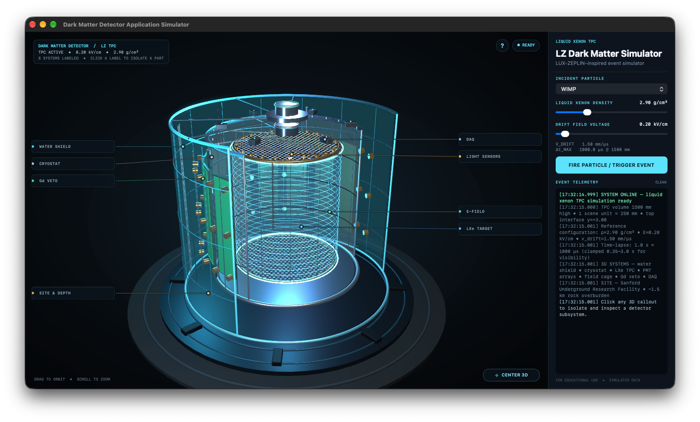

# Dark Matter Detector Application Simulator

A native macOS simulator of a dual-phase liquid-xenon time projection chamber (TPC), inspired by the LZ and XENONnT dark-matter experiments. Select a particle, tune the detector, fire events, and watch the full S1 → electron drift → S2 event loop unfold in a procedural 3D scene.



## Features

- **Procedural 3D detector** built entirely with SceneKit geometry: translucent water shield, titanium cryostat, LXe TPC, field cage, top and bottom PMT arrays, Gd-loaded veto panels, DAQ hardware, supports, and underground-site base.
- **Interactive component inspector** with eight 3D-anchored labels. Click a label to isolate a subsystem and read its description in the HUD.
- **Particle event simulation** for a WIMP, background neutron, or cosmic-ray electron. Events include randomized interaction positions, S1 scintillation, upward electron drift, and S2 electroluminescence at the liquid-gas interface.
- **Live detector controls** for liquid-xenon density and drift-field voltage. The drift readout, HUD, and next event update while the sliders move.
- **Continuous firing** with a latched **FIRE PARTICLE / TRIGGER EVENT** button. Press once to run repeated events; press **STOP FIRING** to let the current event finish and stop.
- **Terminal-style telemetry** with coordinates, depth, drift velocity, simulated drift time, S1/S2 photoelectron estimates, S2/S1 ratio, confidence, and a deterministic candidate/veto ruling.
- **Field guide help window** covering the detector systems, event loop, signal interpretation, simplified physics, background rejection, and educational limitations.
- **Camera controls** for orbit and zoom, plus a **⌖ CENTER 3D** button (`⌘0`) that restores the home framing.
- 100% programmatic AppKit UI. No storyboard, XIB, Interface Builder, or external 3D models.

## Requirements

- macOS 13.0 or newer
- Xcode 27 or newer
- [XcodeGen](https://github.com/yonaskolb/XcodeGen) only if you want to regenerate the Xcode project from `project.yml`

## Build and Run

The generated `DarkMatterDetector.xcodeproj` is included. From the repository root:

```bash
xcodebuild \
  -project DarkMatterDetector.xcodeproj \
  -scheme DarkMatterDetector \
  -configuration Debug \
  -derivedDataPath build \
  CODE_SIGNING_ALLOWED=NO \
  build

open build/Build/Products/Debug/DarkMatterDetector.app
```

If you change `project.yml`, regenerate the project first:

```bash
xcodegen generate
```

You can also open `DarkMatterDetector.xcodeproj` in Xcode and run the `DarkMatterDetector` scheme.

## Tests

The simulation engine has ten unit tests covering reference drift velocity, field/density scaling, drift time, clamping, classification, and signal ordering.

```bash
xcodebuild \
  -project DarkMatterDetector.xcodeproj \
  -scheme DarkMatterDetector \
  -configuration Debug \
  -derivedDataPath build \
  CODE_SIGNING_ALLOWED=NO \
  test
```

## Controls

| Control | Action |
| --- | --- |
| Incident Particle | Choose WIMP, Background Neutron, or Cosmic Ray Electron |
| Liquid Xenon Density | Set density from 2.5 to 4.0 g/cm³; affects scattering and drift speed |
| Drift Field Voltage | Set field from 0.1 to 2.0 kV/cm; higher field means faster electron drift |
| FIRE PARTICLE / TRIGGER EVENT | Start continuous event firing; press again to stop after the current event |
| Component labels | Isolate the selected detector subsystem |
| Drag / scroll in the 3D view | Orbit / zoom the camera |
| ⌖ CENTER 3D or ⌘0 | Restore the home camera position, target, and zoom |
| `?` beside READY, or Help menu | Open the field guide (`⌘?`) |
| Return | Start firing from the main window |
| Escape | Close the help window |

## What Is Simulated

### The event loop

1. A particle deposits energy at a random point inside the active LXe volume.
2. **S1** prompt scintillation is rendered as a white-blue flash at the interaction point.
3. Ionization electrons drift upward under the electric field. The yellow tracer and particle trail follow the computed drift path.
4. **S2** electroluminescence appears at the liquid-gas interface as an orange-white flash near the top PMT plane.
5. The terminal compares the simulated S1 and S2 signals and labels the event as a dark-matter candidate or a vetoed background.

### Drift model

The educational model uses the reference conditions of 0.20 kV/cm, 2.90 g/cm³, and 1.50 mm/µs:

```text
v_drift = 1.50 mm/µs × (E / 0.20 kV/cm) × (2.90 g/cm³ / ρ)
Δt      = depth / v_drift
```

Velocity is clamped to 0.15–6.00 mm/µs. A full-depth 1500 mm event at reference settings takes about 1000 µs. The visual drift is time-lapsed for legibility: roughly 1 second on screen represents 1000 µs, clamped to 0.35–3.0 seconds, while the terminal always reports the exact simulated microseconds.

### Classification

- **WIMP**: an in-fiducial nuclear recoil that passes the generous educational signal window produces the confirmed-candidate alert.
- **Background neutron**: also a nuclear recoil, but vetoed in this single-scatter demonstration.
- **Cosmic-ray electron**: an electronic recoil with a high S2/S1 ratio, vetoed by the nuclear-recoil discrimination band.

The candidate/veto decision is deterministic by particle type and fiducial position. Signal counts and confidence percentages are illustrative, not a scientific analysis.

## Project Layout

```text
dark-matter-detector/
├── DarkMatterDetector/
│   ├── AppDelegate.h/.m                  # app lifecycle, menus, help window routing
│   ├── ViewController.h/.m               # programmatic UI, animations, live controls
│   ├── DetectorSceneBuilder.h/.m         # procedural SceneKit detector
│   ├── DetectorSimulationEngine.h/.m     # physics and event classification
│   ├── DMDComponentOverlayView.h/.m      # projected 3D component labels
│   ├── DMDDetectorPart.h/.m              # subsystem metadata
│   ├── DMDHelpWindowController.h/.m      # scrollable field guide
│   ├── DMDPhysicsConstants.h/.m          # shared physical/model constants
│   ├── Info.plist                        # bundle metadata and CFBundleIconFile
│   ├── AppIcon.icns                      # application icon
│   ├── main.m
│   └── ...
├── DarkMatterDetectorTests/
│   └── DetectorSimulationEngineTests.m
├── tools/
│   └── generate_app_icon.py              # reproducible procedural icon generator
├── preview.png                           # screenshot used above
├── project.yml                           # XcodeGen definition
├── DarkMatterDetector.xcodeproj
└── .gitignore
```

## App Icon

The application icon is a procedural dark-matter-detector target with a liquid-xenon TPC, gold sensor ring, S1 flash, upward drift track, and S2 flash. It is stored as `DarkMatterDetector/AppIcon.icns` and referenced by `CFBundleIconFile`.

To regenerate it, install Python 3 with Pillow and NumPy, then run:

```bash
python3 tools/generate_app_icon.py --preview-dir build/icon-preview
```

`iconutil` is part of macOS and is used to assemble the `.icns` file.

## Notes and Limitations

- The app is an educational visualization, not a detector calibration, statistical analysis, or dark-matter discovery tool.
- The 3D geometry and signal yields are deliberately simplified. The real LZ detector is a much larger, more complex instrument.
- This project is independently produced and is not affiliated with the LZ or XENONnT collaborations.
